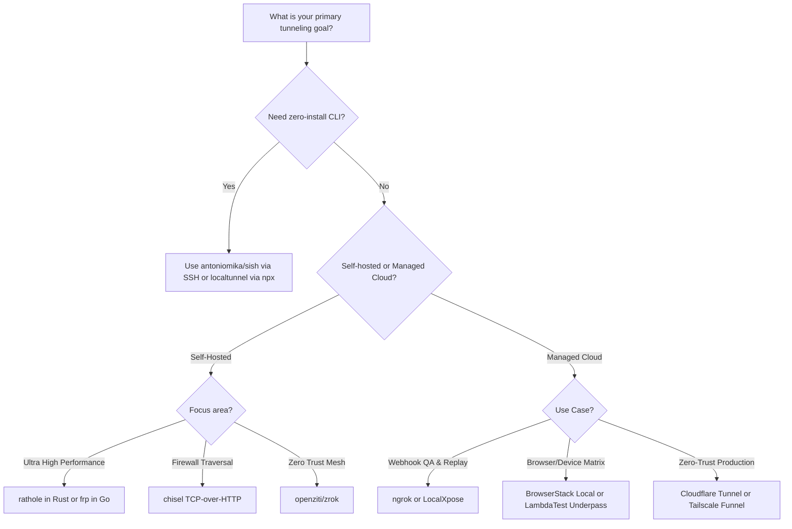

<div align="center">

# 🚀 Awesome Secure Local Tunnel & Proxy Services

<a href="https://github.com/ishandutta2007/Awesome-Awesome-Awesome"></a><a href="https://discord.gg/jc4xtF58Ve"></a>
[](https://github.com/ishandutta2007/Awesome-Awesome-Awesome)
[](https://creativecommons.org/publicdomain/zero/1.0/)
[](https://github.com/ishandutta2007/Awesome-Secure-Local-Tunnel-Proxy-Service/pulls)
[](https://github.com/ishandutta2007/Awesome-Secure-Local-Tunnel-Proxy-Service/graphs/commit-activity)
<a href="https://github.com/ishandutta2007"></a>

<p align="center">
  
</p>

**A curated, production-grade guide to secure local tunneling, reverse proxies, and NAT traversal tools.**  
Expose `localhost` safely to the public internet for webhook debugging, cross-browser/mobile QA testing, client demos, and IoT integrations.

[🌟 Star on GitHub](https://github.com/ishandutta2007/Awesome-Secure-Local-Tunnel-Proxy-Service) • [📋 SaaS Table](#-commercial--saas-tunnel-platforms) • [🛠️ Open-Source Tools](#-open-source-software--self-hosted-solutions) • [🤝 Contributing](#-contributing)

</div>

---

## 📑 Table of Contents

- [🌐 Overview & Key Architecture](#-overview--key-architecture)
- [📈 Sector Overview & Market Dynamics](#-sector-overview--market-dynamics)
- [🏢 Commercial & SaaS Tunnel Platforms](#-commercial--saas-tunnel-platforms)
- [💻 Open-Source Software & Self-Hosted Solutions](#-open-source-software--self-hosted-solutions)
- [⚖️ Feature & Architecture Comparison](#-feature--architecture-comparison)
- [🎯 Choosing the Right Tool](#-choosing-the-right-tool)
- [🤝 Contributing](#-contributing)
- [💖 Support & Sponsorship](#-support--sponsorship)
- [⭐ Star History](#-star-history)
- [📄 License](#-license)

---

## 🌐 Overview & Key Architecture

Localhost tunneling and reverse-proxy services create encrypted outbound connections from a developer's workstation or private network (`localhost:[port]`) to an external edge relay or gateway, routing inbound public HTTP/HTTPS/TCP traffic backward through firewalls and NAT without port forwarding.

```
+------------------+         Encrypted Tunnel         +----------------------+         Public Internet
| Local Workstation| ===============================> | Edge / Ingress Relay | <============================= [ Stripe / GitHub / Client ]
|  localhost:3000  |  (SSH / WireGuard / HTTP/2 Mux)  | (Cloudflare / ngrok) |   https://tunnel.example.com
+------------------+                                  +----------------------+
```

### 🔑 Primary Use Cases
- 🪝 **Webhook Integration & Debugging:** Receive real-time webhooks locally from Stripe, GitHub, Shopify, Twilio, and Slack.
- 📱 **Mobile & Cross-Device Testing:** Test responsive builds on actual physical mobile devices or remote cloud device grids.
- 🤝 **Live Client Previews:** Share work-in-progress websites and APIs with clients and stakeholders without cloud deployment.
- 🤖 **AI Agents & MCP Servers:** Expose local Model Context Protocol (MCP) daemons, local LLM endpoints, and serverless callback handlers.
- 🛡️ **Zero-Trust Remote Access:** Securely access homelab dashboards, internal staging environments, and IoT nodes.

---

## 📈 Sector Overview & Market Dynamics

> 💡 **Market Size:** The developer-facing secure local tunneling and edge ingress market is an integral driver of the broader **$170B+ Global Developer Tools (DevTools) & Edge Ingress Ecosystem**, addressing a rapidly growing global base of over **28+ million software engineers**.
>
> 🔄 **Market Concentration & Fragmentation:** The sector is **moderately to highly fragmented**—characterized by a bifurcated competitive landscape. While hyperscale edge security providers (**Cloudflare**) and pioneer incumbents (**ngrok**) anchor enterprise brand dominance, strict freemium usage caps and bandwidth quotas have propelled a flourishing, highly active long-tail of specialized alternatives and community-backed open-source projects (**frp**, **localtunnel**, **rathole**, **chisel**).

---

## 🏢 Commercial & SaaS Tunnel Platforms

Commercial cloud-hosted tunneling services provide turnkey global relays, managed SSL/TLS termination, access authentication, and inspection dashboards. 

The table below is sorted by **Company Size (Revenue / Enterprise Valuation, Descending)**:

| 🏢 Platform | 💰 Company Size (Valuation / Revenue) | 🏷️ Starting Paid Plan | 🎁 Free Tier / Trial Limit | 🛠️ Tunnel Type & Key Focus |
|:---|:---|:---|:---|:---|
| [**Cloudflare Tunnel**](https://developers.cloudflare.com/cloudflare-one/connections/connect-networks/) | **~$95B – $105B Market Cap** ($2.17B+ Annual Revenue) | **$7 / user / month** (Cloudflare Zero Trust Pay-as-you-go) | **Free Forever:** Up to 50 users, unlimited bandwidth & requests, persistent named tunnels, Zero-Trust access rules | Zero-trust outbound daemon (`cloudflared`) terminating directly at Cloudflare's global edge network. |
| [**BrowserStack Local**](https://www.browserstack.com/local-testing) | **$4.0B Valuation** (~$225M+ ARR) | **$29 / user / month** (Desktop Live billed annually) | **Free Trial:** 30 total minutes (capped at 1 min/session per device); 100 screenshots; 100 mins automated testing | Dedicated testing tunnel with desktop app & binary CLI; native integration with 3,500+ cloud browser/OS matrices. |
| [**Tailscale Funnel**](https://tailscale.com/kb/1223/funnel) | **$1.5B Valuation** (~$45M+ ARR) | **$8 / active user / month** (Standard plan) | **Free Forever (Personal):** Up to 6 users, unlimited devices, Tailscale Funnel included on ports 443/8443/10000 | WireGuard mesh tunnel routing traffic into private tailnet and exposing endpoints via MagicDNS subdomains. |
| [**Sauce Connect Tunnel**](https://saucelabs.com/platform/sauce-connect-proxy) | **~$613M Valuation** (~$95M+ ARR) | **$39 / month** (Live Testing billed annually) | **Free Trial:** 28-day free trial with full testing features & Sauce Connect proxy support | Secure enterprise proxy tunnel establishing encrypted link to Sauce Labs real device cloud & browser emulators. |
| [**LambdaTest Underpass**](https://www.lambdatest.com/support/docs/underpass-tunnel-application/) | **~$400M Valuation** (~$35M – $100M+ ARR) | **$15 / month** (Virtual Live testing) | **Free Forever Plan:** 60 mins/month live interactive testing (10-min sessions); Underpass desktop GUI tunnel included | GUI desktop client with SSH tunnel and MITM mode for testing internal staging & self-signed certificates. |
| [**ngrok**](https://ngrok.com/) | **~$250M – $500M Valuation** (~$25M – $30M ARR) | **$8 / month** (Hobbyist tier billed annually; or $10/mo) | **Free Forever:** 1 dev domain, 3 concurrent endpoints, 1 GB/mo egress, 20,000 HTTP reqs/mo, browser warning page | Industry-standard developer ingress tunnel with HTTP request inspector, payload replay, and TCP/TLS options. |
| [**LocalXpose**](https://localxpose.io/) | **Bootstrapped / Indie-scale** (Undisclosed private) | **$8 / month** (Pro plan billed annually; or $10/mo) | **Free Forever (Starter):** 2 active HTTP/HTTPS tunnels, 15-min timeout per session, interstitial browser warning | Lightweight alternative to ngrok supporting HTTP/HTTPS, TLS, TCP, and UDP port forwarding. |
| [**PageKite**](https://pagekite.net/) | **Indie / FOSS SaaS** (Undisclosed private) | **$3 / month** (Pay-what-you-want) / **$5.99 / mo** (Pro) | **Free Trial:** 31-day trial (2.5 GB transfer); permanent free tier for verified open-source maintainers | Python-based reverse-proxy and dynamic DNS service running since 2011 with open-source client (`pagekite.py`). |

---

## 💻 Open-Source Software & Self-Hosted Solutions

Self-hosted, transparent, and quota-free open-source reverse proxies and NAT traversal tunnels. Run the server daemon on your own VPS or Kubernetes cluster to eliminate vendor lock-in, data egress limits, and interstitial warning pages.

The table below is sorted by **GitHub Stars (Descending)**:

| 📦 Repository & Project | ⭐ GitHub Stars | 🛠️ Tech Stack | 📜 License | 💡 Architecture & Key Highlights |
|:---|:---:|:---:|:---:|:---|
| [**fatedier/frp**](https://github.com/fatedier/frp) | [](https://github.com/fatedier/frp/stargazers) | Go | Apache-2.0 | Ultra-fast, battle-tested reverse proxy supporting TCP, UDP, HTTP, HTTPS, and STCP (secret TCP). Features custom subdomain routing, dashboard, and connection pooling. |
| [**ehang-io/nps**](https://github.com/ehang-io/nps) | [](https://github.com/ehang-io/nps/stargazers) | Go | Apache-2.0 | Full-featured intranet penetration proxy server with a web-based administration management GUI, multi-tenant user access, and TCP/UDP/SOCKS5 proxying. |
| [**localtunnel/localtunnel**](https://github.com/localtunnel/localtunnel) | [](https://github.com/localtunnel/localtunnel/stargazers) | Node.js | MIT | Instant localhost exposure via `npx localtunnel --port 8000`. Both client CLI and server hub are fully open-source with simple DNS wildcard support. |
| [**jpillora/chisel**](https://github.com/jpillora/chisel) | [](https://github.com/jpillora/chisel/stargazers) | Go | MIT | Fast TCP/UDP tunnel transported over HTTP and secured via SSH. Single standalone binary for client and server with automatic reconnection and reverse port forwarding. |
| [**cloudflare/cloudflared**](https://github.com/cloudflare/cloudflared) | [](https://github.com/cloudflare/cloudflared/stargazers) | Go | Apache-2.0 | Official open-source client for Cloudflare Tunnel. Connects local services to Cloudflare edge via HTTP/2 or QUIC without opening any inbound firewall ports. |
| [**rathole-org/rathole**](https://github.com/rathole-org/rathole) | [](https://github.com/rathole-org/rathole/stargazers) | Rust | Apache-2.0 / MIT | High-performance, memory-efficient NAT traversal tunnel written in Rust. Engineered with Tokio async I/O and Noise protocol encryption as a lightweight alternative to frp. |
| [**ekzhang/bore**](https://github.com/ekzhang/bore) | [](https://github.com/ekzhang/bore/stargazers) | Rust | MIT | Minimalist, modern CLI TCP tunnel in Rust (~400 lines of async code). Forwards any local port to a public server with zero configuration: `bore local 8000 --to bore.pub`. |
| [**antoniomika/sish**](https://github.com/antoniomika/sish) | [](https://github.com/antoniomika/sish/stargazers) | Go | MIT | Open-source alternative to Serveo and ngrok that provides HTTP, HTTPS, WS, and TCP tunnels over pure SSH. Requires no client installation: `ssh -R 80:localhost:3000 sish`. |
| [**openziti/zrok**](https://github.com/openziti/zrok) | [](https://github.com/openziti/zrok/stargazers) | Go | Apache-2.0 | Next-generation peer-to-peer sharing and tunneling platform built on OpenZiti Zero Trust overlay networking. Supports public and private peer-to-peer shares. |
| [**davrodpin/mole**](https://github.com/davrodpin/mole) | [](https://github.com/davrodpin/mole/stargazers) | Go | Apache-2.0 | CLI tool for easily creating SSH tunnels, local port forwarding, and remote port forwarding with built-in alias configuration and automatic key lookup. |
| [**inlets/inlets-operator**](https://github.com/inlets/inlets-operator) | [](https://github.com/inlets/inlets-operator/stargazers) | Go | MIT | Cloud-native Kubernetes controller that automatically provisions public cloud exit-nodes and connects internal ClusterIP/LoadBalancer services securely. |
| [**pagekite/PyPagekite**](https://github.com/pagekite/PyPagekite) | [](https://github.com/pagekite/PyPagekite/stargazers) | Python | AGPL-3.0 | The official Python implementation of the PageKite tunneling protocol. Runs as a standalone reverse proxy to publish local web servers, SSH, and raw TCP streams. |

---

## ⚖️ Feature & Architecture Comparison

| Software | Core Architecture | Protocols Supported | Egress / Traffic Limit | Self-Hostable | Persistent URL Support | Custom Domain | Best Match For |
|:---|:---|:---|:---|:---:|:---:|:---:|:---|
| ☁️ **Cloudflare Tunnel** | Edge Daemon (QUIC/H2) | HTTP, HTTPS, TCP, SSH, RDP | Unlimited | ❌ (Client OSS) | ✅ Yes (Named) | ✅ Yes (Free) | Production Zero-Trust access & persistent APIs |
| 🌐 **frp** | TCP/STCP Multiplexing | HTTP, HTTPS, TCP, UDP, STCP | Unlimited (Self-infra) | ✅ Yes | ✅ Yes (DNS CNAME) | ✅ Yes | High-traffic self-hosted NAT traversal |
| 🪓 **chisel** | SSH over HTTP/WebSockets | TCP, UDP | Unlimited (Self-infra) | ✅ Yes | ✅ Yes | ✅ Yes | Bypassing restrictive firewalls & proxies |
| 🦀 **rathole** | Async Tokio + Noise Protocol | TCP, UDP | Unlimited (Self-infra) | ✅ Yes | ✅ Yes | ✅ Yes | Low-resource VPS & high-concurrency tunneling |
| 🎯 **ngrok** | Edge Ingress Proxy | HTTP, HTTPS, TCP, TLS | 1 GB/mo (Free) | ❌ | ❌ (Paid) | ❌ (Paid) | Fast webhook inspection & dev API demos |
| 💻 **localtunnel** | Node.js Proxy | HTTP, HTTPS | Bandwidth dependent | ✅ Yes | ❌ (Dynamic) | ❌ | Rapid zero-config testing without account |
| 🔑 **sish** | SSH Port Forwarding | HTTP, HTTPS, TCP, WS | Unlimited (Self-infra) | ✅ Yes | ✅ Yes | ✅ Yes | Tunneling from machines without sudo/binaries |
| 🔒 **Tailscale Funnel** | WireGuard Overlay + Edge | HTTPS, TLS | Capped bandwidth | ❌ (Client OSS) | ✅ Yes (Tailnet) | ❌ (`.ts.net`) | Engineers already using Tailscale private mesh |
| 🧪 **BrowserStack Local** | Testing Agent Binary/App | HTTP, HTTPS, SSL MITM | Test session quota | ❌ | ❌ | ❌ | Automated cross-browser QA & local staging |
| 🧪 **LambdaTest Underpass**| GUI SSH Tunnel + MITM | HTTP, HTTPS, Cert MITM | Test session quota | ❌ | ❌ | ❌ | Manual QA teams needing graphical setup |

---

## 🎯 Choosing the Right Tool



---

## 🤝 Contributing

Contributions are warmly encouraged! If you have built or discovered an awesome secure local tunnel, reverse proxy, or NAT traversal utility:

1. 🍴 **Fork** this repository.
2. 🌿 **Create a new branch**: `git checkout -b feature/add-new-tunnel`.
3. 📝 **Add your entry** in alphabetical or appropriate sorted position following existing formats.
4. ⭐ **Ensure** the tool is actively maintained with valid licensing.
5. 🚀 **Submit a Pull Request** with a concise description of why it stands out.

---

## 💖 Support & Sponsorship

Thank you so much for exploring and using **Awesome Secure Local Tunnel & Proxy Services**! 💖

If you found this curated list helpful for your developer workflows, webhook debugging, or team testing infrastructure, please consider supporting the project:

- ⭐ **Star this repository** to help others discover it!
- 🍴 **Fork and contribute** by adding new tools or updating features.
- 📢 **Share it** with fellow engineers, QA teams, and DevOps communities.
- ☕ **Buy me a coffee / Sponsor:** Support ongoing open-source curation and development via the [GitHub Sponsors Dashboard](https://github.com/sponsors/ishandutta2007).

<div align="center">

[](https://github.com/sponsors/ishandutta2007)

</div>

---

## ⭐ Star History

[](https://www.star-history.com/#ishandutta2077/Awesome-Secure-Local-Tunnel-Proxy-Service&type=date&legend=top-left)

---

## 📄 License

This repository and curated list are licensed under [CC0 1.0 Universal (Public Domain)](LICENSE). Individual listed tools and projects are licensed under their respective authors' licenses.

<div align="center">

**[⬆️ Back to Top](#-awesome-secure-local-tunnel--proxy-services)**

⭐ **Found this resource valuable? Don't forget to star the repository!** ⭐

</div>
